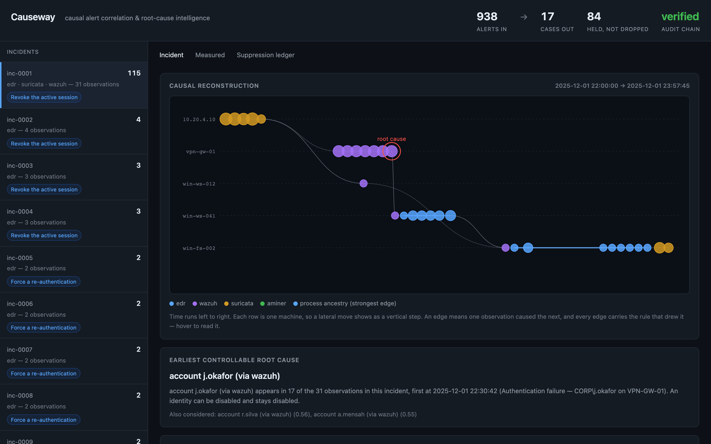
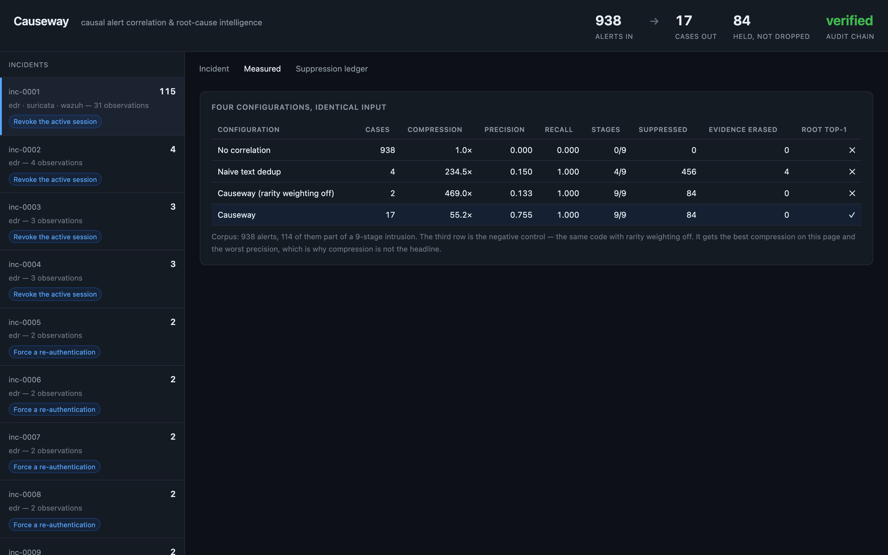
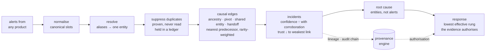

<h1 align="center">Causeway</h1>

<p align="center"><strong>Causal SOC alert correlation and root-cause intelligence.</strong><br/>
From 938 alerts to 17 cases, the right root cause, and the smallest action that would have stopped the intrusion — with the evidence for every step, and a written refusal for every step it will not take.</p>

<p align="center">
<a href="https://github.com/ShaanGS/Causeway/actions/workflows/ci.yml"></a>


<a href="LICENSE"></a>
</p>

<p align="center">
<a href="#try-it-in-two-minutes">Try it</a> ·
<a href="#the-result">Results</a> ·
<a href="#how-it-works">How it works</a> ·
<a href="#every-claim-and-where-to-check-it">Evidence</a> ·
<a href="docs/ARCHITECTURE.md">Architecture</a> ·
<a href="docs/API.md">CLI &amp; API</a> ·
<a href="docs/adr/">Decisions</a> ·
<a href="#limits">Limits</a>
</p>

Built for **PS2 — Causal SOC Alert Correlation & Root-Cause Intelligence**
(Microsoft Innovation Club, VIT Chennai).



## The problem

A single attacker action produces dozens of technically correct alerts across products that
do not agree on what to call a person, a machine, or an address. The queue shows them as
unrelated rows. Naive deduplication merges alerts that *read* the same and erases the
attack's own stages. Automated response either does nothing or isolates a production server
at 3 a.m. because a reputation feed had an opinion.

Causeway reconstructs the causal incident behind the rows, names the earliest thing an
organisation could actually have contained, suppresses only provable duplicates, and
recommends the smallest action that would stop the intrusion. No model and no network call
anywhere in the decision path: the pipeline runs in about 25 ms on the lab corpus and under
a second on 45,000 real alerts.

## Try it in two minutes

```bash
git clone https://github.com/ShaanGS/Causeway.git && cd Causeway
python3 -m venv .venv && source .venv/bin/activate
pip install -e ".[server,dev]"
```

```bash
causeway run                 # correlate the lab corpus, print the cases
causeway run -v --top 1      # the headline case with every observation and edge
causeway metrics             # the results table below, written to results/lab.json
causeway serve               # the console at http://127.0.0.1:8788
pytest                       # 51 tests, ~2 s
```

`make check` runs lint, types and tests. `make docker` builds and serves the console in a
container. `causeway run your-alerts.jsonl` correlates your own data; the format is in
[docs/API.md](docs/API.md).

What `causeway run --top 1` prints:

```
inc-0001  115 alerts / 31 observations  edr, suricata, wazuh  2025-12-01 22:00:00 -> 2025-12-01 23:57:45
  confidence 1.00   evidence: Single sensor
  root #1  account j.okafor (via wazuh)             score 0.754
  root #2  account r.silva (via wazuh)              score 0.561
  root #3  account a.mensah (via wazuh)             score 0.549
  recommend  Revoke the active session  [session.revoke]
  withheld   This incident already spans 31 observations across 3 products, so force a
             re-authentication would not end access the attacker already holds. Revoke the
             active session is the smallest rung that does. Disable the account needs Analyst
             approved; the evidence for account j.okafor (via wazuh) is Corroborated telemetry.
```

## The result

938 alerts from four products over one night, containing a nine-stage intrusion.

```
configuration                   cases  compression  precision  recall  stages  erased  root top-1
No correlation                    938         1.0×      0.000   0.000     0/9       0          ✕
Naive text dedup                    4       234.5×      0.150   1.000     4/9       4          ✕
Causeway (rarity weighting off)     2       469.0×      0.133   1.000     9/9       0          ✕
Causeway                           17        55.2×      0.755   1.000     9/9       0          ✓
```

`causeway metrics` regenerates this table and writes it to `results/lab.json`. No document
here quotes a number that command did not write.

**Read the third row before the fourth.** It is the same code with one mechanism disabled,
and it achieves the *best compression on the page* while getting the root cause wrong and
scoring the worst precision. Compression is the metric this problem invites you to optimise
and it is the one most easily faked by merging aggressively. That row is why it is not our
headline.

**Read the second row too.** Merging on what an alert *says* buries the successful login —
the actual root cause — underneath a routine one, because the two produce the same sentence.
It recovers four of nine stages and erases evidence four times. This is not a strawman; it
is what queue tooling does by default, and the PS names it as a hazard.

The one incident that matters holds **115 alerts, all nine stages, 31 observations across
three products**, and its top-ranked root cause is correct.



### On somebody else's data

The same four configurations over the public **AIT Alert Data Set** (scenario
`russellmitchell`: 45,544 real alerts from AMiner, Wazuh and Suricata, 12,015 of them inside
a published ten-stage attack). Nothing was tuned to it.

```
configuration                   cases  compression  precision  recall  stages  erased  root top-1
No correlation                  45544         1.0×      0.000   0.000    0/10       0        n/a
Naive text dedup                  121       376.4×      0.273   0.992    7/10    8545        n/a
Causeway (rarity weighting off)    90       506.0×      0.266   0.999    8/10       0        n/a
Causeway                          950        47.9×      0.122   0.337    7/10       0        n/a
```

`causeway metrics ait --window 5` regenerates it (`results/ait-russellmitchell.json`). The
dataset publishes attack windows but no root-cause entity, so that column is not gradable.

Two things this table says that flatter nobody. First, the negative control wins on recall
here: the attack is a quarter of the whole stream, so "the attack is rare" — the prior
behind rarity weighting — is false on this corpus, and treating every entity as
distinctive happens to work. Second, the first run of Causeway on this data scored a recall
of 0.02. Reading why produced the change recorded in
[ADR 0004](docs/adr/0004-ubiquity-is-degree-and-frequency.md), which lifted it to 0.34 and
seven stages without moving a single number on the lab corpus. It is still the weakest row
on the page and it is reported as such.

## How it works



Six stages, no model and no network call in any of them. The full data flow with module
names is in [docs/ARCHITECTURE.md](docs/ARCHITECTURE.md).

**Normalise.** Every product's alert is pulled into canonical entity slots. A sensor with no
opinion about a slot omits it; correlation never joins on a missing value.

**Resolve.** `CORP\j.okafor`, `j.okafor@corp.local` and `S-1-5-21-1004-1104` are one person.
Until they spell the same, nothing downstream can join on them.

**Suppress duplicates — and only duplicates.** A merge requires *same rule ∧ same sensor ∧
identical resolved entity tuple ∧ inside the repeat window*. Never text. Everything
suppressed goes to a ledger with its grounds and stays retrievable. Compression that loses
evidence is data loss with a metric attached.

**Draw causal edges.** Three ideas carry this:

- *Precedence.* Every edge points forward in time, so the graph is a DAG and "what did this
  lead to" has an answer.
- *Nearest predecessor, not every predecessor.* Linking to all of them yields a clique — one
  blob per busy host, technically connected and unreadable. Chains are what an analyst follows.
- *Ubiquitous entities carry no signal.* The domain controller appears in everything, as does
  the vulnerability scanner's address. Each entity is weighted by how distinctive it is, and
  ubiquity is tested two ways: by **frequency** (how many observations mention it) and by
  **degree** (how many distinct other entities it is seen with). An entity is discounted only
  when both tests call it a hub. The second test exists because of the public corpus: a loud
  attacker generated a quarter of the stream, looked like infrastructure by frequency alone,
  and every edge that mattered was weighted away. Loud is not the same as everywhere.

Process ancestry (`ppid → pid`) is exempt from weighting: a parent pid *is* causation.

**Rank root causes — as entities, not alerts.** Nobody contains an alert. They disable an
account, isolate a host, block an address. Ranking alerts put a *failed* authentication on
top, which looked like a bug until the obvious objection landed: containing `j.okafor` at the
moment of the spray genuinely would have stopped the attack. The ranking was right and the
question was wrong. Scoring entities makes the failed spray attempt and the successful login
resolve to the same answer, which is what a responder needed either way.

Controllability is weighted by kind, because an identity can be disabled and stays disabled
while an address is chosen by the attacker and costs nothing to change. Blocking the address
is the move that feels decisive and accomplishes least.

**Recommend the smallest sufficient action.** A ladder ordered by disruption, gated on
evidence:

```
annotate < notify < re-authenticate < revoke session < rotate credential
         < isolate host < disable account
```

Take the lowest rung that is both *effective* against the thing being contained and
*authorised* by the evidence. An MFA challenge is real interference and no help against a
session the attacker already holds — "smallest safe action" and "smallest safe action **that
stops progression**" are different requests, and the PS asks for the second.

The interesting output is the refusal, not the recommendation:

> *Disable the account needs Analyst approved; the evidence for account j.okafor is
> Corroborated telemetry.*

That tells an analyst what the system would need to go further. A control that only says no
gets switched off.

### Where the provenance engine comes in

`ventriloquist/` is a provenance gateway built for an earlier project and vendored here
unchanged apart from six additive origin kinds. It contributes three things this problem
needs and it would have been wasteful to rebuild:

| what it does | where it lands here |
|---|---|
| lineage as a transitive origin closure | "which cases rest on this entity" is a filter, not a graph walk — including cases nobody linked to it by name |
| `blast_radius()` — pure hypothetical re-evaluation | the containment preview: *contain this and here is what stops standing up*, in ~190 µs |
| a tamper-evident hash chain | every correlation, suppression and refusal is an audit event; the console is only a projection of it |
| quarantine as hold-not-delete | the suppression ledger inherits the principle: refusals must be recoverable |

**What it does not do is the correlation.** It is *handed* lineage by an agent's turn
context; a SOC is handed nothing, and inferring the edges is the new work. Claiming
otherwise is the seam a sharp reviewer would find first.

### The one thing worth arguing about

The engine's rule is `min()` — a claim is only as strong as its weakest source. Applied
naively to an incident, that is perverse: a network sensor's port-scan alert joining a case
*lowers* what the case may authorise, so acquiring more evidence removes your ability to
act. It would train anyone to keep cases narrow.

So authorisation is evaluated against the **target entity's** lineage, not the incident's.
What matters when revoking `j.okafor`'s session is how well attested *j.okafor* is. A port
scan elsewhere in the same case is irrelevant to that; a threat feed being the only thing
that ever mentioned the account is decisive against it. The weakest-link rule survives where
it belongs and stops punishing breadth.

Correlation confidence and evidentiary trust are kept as two numbers throughout, and they
move in opposite directions by design. An incident can be near-certain its alerts belong
together and still be barred from disruptive action — certainty that a story hangs together
is not certainty about who did it. Collapsing them into one score is how correlation tools
end up either over-escalating or refusing to act at all.

## Every claim, and where to check it

| claim | code | proof |
|---|---|---|
| Alerts from different products are correlated into causal incidents | [correlate.py](causeway/correlate.py), [incident.py](causeway/incident.py) | [`test_the_whole_kill_chain_lands_in_one_incident`](tests/test_causeway.py#L164) |
| Every edge points forward in time | [correlate.py:181-207](causeway/correlate.py#L181-L207) | [`test_every_edge_points_forward_in_time`](tests/test_causeway.py#L128) |
| Fragmented entity context is resolved | [entities.py:87-110](causeway/entities.py#L87-L110) | [`test_four_spellings_of_one_person_resolve_to_one`](tests/test_causeway.py#L60), [`test_a_process_is_scoped_to_its_host`](tests/test_causeway.py#L67) |
| Duplicates are proven, never read, and never dropped | [dedup.py:148-172](causeway/dedup.py#L148-L172), [`Ledger`](causeway/dedup.py#L119) | [`test_causal_dedup_erases_no_evidence`](tests/test_causeway.py#L89), [`test_suppressed_alerts_are_held_not_dropped`](tests/test_causeway.py#L106) |
| The naive baseline really does bury the root cause | [`naive_text_group`](causeway/dedup.py#L182) | [`test_naive_text_dedup_erases_the_root_cause`](tests/test_causeway.py#L97) |
| Hubs carry no signal, but loud is not ubiquitous | [`entity_weights`](causeway/correlate.py#L104) | [`test_ubiquitous_entities_carry_little_weight`](tests/test_causeway.py#L134), [`test_loud_is_not_the_same_as_ubiquitous`](tests/test_causeway.py#L140) |
| Rarity weighting is load-bearing, not decoration | [metrics.py](causeway/metrics.py) | [`test_rarity_weighting_is_load_bearing`](tests/test_causeway.py#L265) |
| The root cause is the compromised identity, never an address | [rootcause.py:41-50](causeway/rootcause.py#L41-L50) | [`test_root_cause_names_the_compromised_identity`](tests/test_causeway.py#L191), [`test_an_address_is_never_the_top_answer`](tests/test_causeway.py#L197) |
| The response is the smallest rung that stops progression | [`recommend`](causeway/response.py#L164) | [`test_the_biggest_incident_gets_a_containing_action`](tests/test_causeway.py#L213) |
| The most destructive rungs still need a human; annotation is never refused | [policies/soc.yaml](causeway/policies/soc.yaml) | [`test_the_most_destructive_rungs_still_need_a_human`](tests/test_causeway.py#L221), [`test_annotation_is_never_refused`](tests/test_causeway.py#L231) |
| Authorisation is against the target's lineage, not the incident's | [`target_provenance`](causeway/response.py#L144) | [`test_confidence_rises_with_corroboration_but_trust_does_not`](tests/test_causeway.py#L170) |
| No correlation rule reads the answer key | every rule module | [`test_no_correlation_rule_reads_the_answer_key`](tests/test_causeway.py#L179) (AST-checked) |
| No model, no network call in the decision path | [ventriloquist/policy.py](ventriloquist/policy.py) | [`test_no_model_or_network_call_in_the_decision_path`](tests/test_causeway.py#L238) |
| Every decision is on a tamper-evident audit chain | [ventriloquist/audit.py](ventriloquist/audit.py) | [`test_the_chain_verifies_after_a_full_ingest`](tests/test_causeway.py#L248) |
| The results table reproduces | [metrics.py](causeway/metrics.py) | [`test_metrics_reproduce`](tests/test_causeway.py#L255), CI runs `causeway metrics` |
| The public-dataset adapter reads the rows as shipped | [adapters/ait.py](causeway/adapters/ait.py) | [tests/test_adapters.py](tests/test_adapters.py), against the exact row shapes |
| The CLI and the API show the same pipeline | [cli.py](causeway/cli.py), [server/app.py](server/app.py) | [tests/test_surfaces.py](tests/test_surfaces.py) |

## Data

The PS makes dataset sourcing the participant's responsibility and requires documented
origin and licensing.

**`causeway/adapters/lab.py` — self-generated lab corpus.** Deterministic (`seed=7`), 938
alerts across four sensor types over 24 simulated hours, containing a nine-stage intrusion
with a published answer key: which alerts belong to the attack, which alert caused which,
and which are true duplicates. Authored for this submission; no third-party data. It exists
because every metric here needs ground truth, and it is built to be *hostile* to the system
measuring against it:

- benign activity fires the attack's own rules — IT automation creates scheduled tasks, the
  backup job moves gigabytes at night, the scanner ports-scans everything on Sundays;
- there are real duplicates, so suppressing nothing would be a failure;
- there are near-duplicates that are **not** duplicates — the attacker's scheduled task and
  the deployment service's read identically. Merging them erases the persistence stage, and
  the false-suppression metric exists to catch exactly that.

**`causeway/adapters/ait.py` — AIT Alert Data Set.** Landauer, Skopik and Wurzenberger,
*Introducing a New Alert Data Set for Multi-Step Attack Analysis*, CSET '24.
[Zenodo 10.5281/zenodo.8263181](https://zenodo.org/records/8263181), **CC BY 4.0**. 2.65 M
labelled alerts from AMiner, Wazuh and Suricata across eight scenarios of a shared attack.
Chosen because it ships **alerts rather than raw logs**, and because three independent
sensors make the PS's "entity context is fragmented" a property of the data rather than
something staged. The archive is not committed (96 MB); download it to `data/raw/ait_ads.zip`
and the adapter finds the scenarios inside it. `data/raw/labels.csv` carries the published
attack windows.

Three things the raw rows do that the adapter has to undo, each found by reading the data
rather than the paper: Suricata findings arrive twice inside Wazuh's envelope (`eve.json`
and `fast.log`) and are attributed to Suricata with the signature id as the rule, so the
relay is not credited with an observation it never made and the ledger can prove the pair
are duplicates; every agent is named `wazuh-client`, so the host comes from the syslog
header only; and addresses carry ports. The duplicate window has to be 5 s on this corpus —
attack stages run as short as 2 s — and [ADR 0005](docs/adr/0005-the-repeat-window-is-a-property-of-the-data.md)
records why.

## Repository

```
causeway/            the product
  schema.py          one alert shape, whatever product emitted it
  entities.py        alias resolution; evidentiary weight per reporting sensor
  dedup.py           provable duplicates only, held in a ledger
  correlate.py       causal edges: ancestry, pivots, shared entities, address handoff
  incident.py        clustering; correlation confidence vs evidentiary trust
  rootcause.py       entities ranked by what containing them would have stopped
  response.py        the ladder, and the refusal in writing
  metrics.py         four configurations, byte-identical input
  corpus.py          the corpus contract every adapter fills
  cli.py             run / metrics / export / serve
  adapters/          lab.py (self-authored, answer key) and ait.py (public)
  policies/soc.yaml  what evidence each response requires; data, not code
ventriloquist/       the vendored provenance engine (lineage, policy, audit chain)
server/              FastAPI surface and the single-file console
tests/               51 tests, including the negative controls
docs/                ARCHITECTURE.md, API.md, adr/ (decision records), img/
results/             what `causeway metrics` last wrote
data/raw/labels.csv  AIT attack windows (the archive itself is downloaded, not committed)
deck/                the submission deck and the script that draws its figure from the pipeline
AGENTS.md            build, test and run instructions and the conventions tests enforce
```

Also: [CONTRIBUTING.md](CONTRIBUTING.md), [SECURITY.md](SECURITY.md),
[CHANGELOG.md](CHANGELOG.md), a `Makefile`, a `Dockerfile`, pre-commit hooks, Dependabot,
and CI on Python 3.11 and 3.12 running ruff, mypy, pytest and the metrics harness.

## Tests

51 tests. The ones that matter are the controls — anything that groups will report
compression, so the tests worth trusting are those that would fail if a mechanism were
quietly doing nothing:

- rarity weighting is load-bearing: with it off, precision must more than halve **and**
  compression must improve, or the headline row was an accident;
- loud is not ubiquitous: an attacker firing 200 alerts at one host must keep its weight
  while a domain controller seen with 200 different people loses it;
- naive text dedup must bury the root cause, or the corpus has stopped being adversarial;
- causal dedup must erase no evidence — nothing suppressed under a representative from a
  different stage;
- no correlation rule may read the answer key (AST-checked);
- the most destructive rungs must still require a human;
- annotation must never be refused;
- every decision runs with `model_calls == 0 and network_calls == 0`;
- the audit chain must verify after a full ingest;
- the AIT adapter is tested against the exact row shapes it was written from, including the
  two encodings of one Suricata finding;
- the CLI and the HTTP API are held to the same pipeline state.

## Limits

Stated because a reviewer will find them anyway.

- **Precision is 0.755 on the lab corpus, not higher.** The wider entity windows that recover
  reconnaissance also pull benign activity on the victim's own host and account into the
  case. For triage that is a trade worth taking — a case carrying surrounding context is
  workable, a case missing its first stage is misleading — but it is a real cost.
- **Recall is 0.34 on the public corpus, and the unweighted control does better.** Rarity
  weighting assumes the attack is a small share of the stream. On AIT it is a quarter of it.
  The degree test closed most of the gap and the rest is reported, not hidden.
- **The duplicate window is a property of the data.** 30 s is safe on the lab corpus and
  wrong on AIT, where it merges across adjacent scanner stages shorter than itself. A
  deployment has to set it from its own shortest stage; nothing here can infer it.
- **Analyst time saved is a model, not a measurement**: pivots avoided × an assumed 3
  minutes per pivot. The assumption is stated in the output rather than buried.
- **Mean time to contain** measures first alert to authorised recommendation. It excludes
  the human who has to approve the rungs that require approval, and pretending otherwise
  would flatter it.
- **Precedence does not change the grouping.** Observations are walked in time order and
  linked to their nearest predecessor, so precedence is structural rather than filtered for,
  and clustering is undirected regardless. It shapes the graph an analyst reads, not the
  clusters. This was the obvious candidate for the negative-control slot and turned out to
  be a no-op; reporting the control that actually bites is the point of having one.
- **The root-cause column is not gradable on AIT.** The dataset publishes stage windows,
  not the entity a responder should have contained, so the harness says *n/a* rather than
  inventing an answer key.

## License

MIT. The AIT Alert Data Set is CC BY 4.0 and is not redistributed here.
