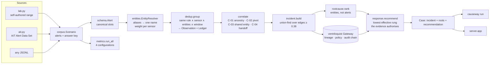

# Architecture

Causeway is a straight pipeline. Every stage is a module that can be read on its own, and
`causeway/pipeline.py` is only the wiring. Nothing in the decision path calls a model or
the network; the whole run is a few hundred pure-Python function calls, which is why it
takes about 25 ms on the lab corpus and under a second on 45,000 real alerts.

## Stage by stage

### 1. Sources and the corpus contract (`corpus.py`, `adapters/`)

Every adapter produces a `Scenario`: alerts plus whatever answer key the source can
honestly supply. The lab range supplies everything (stage per alert, parent per alert,
which alerts are true duplicates, the root entity). The AIT dataset supplies stage windows
only, so its `root_ref` is empty and the harness reports the root-cause column as *n/a*
rather than inventing one. A plain JSONL file supplies whatever `stage` values it carries.

### 2. Normalise (`schema.py`)

One `Alert` shape with nine canonical entity slots: `user, host, src_ip, dst_ip, process,
pid, ppid, file, hash`. A sensor with no opinion about a slot omits it; an absent slot is
never joined on. `stage` is the ground-truth label and is read by the metrics harness only.

### 3. Resolve (`entities.py`)

`EntityResolver` folds `CORP\j.okafor`, `j.okafor@corp.local` and a SID onto one name, and
turns every entity into a ventriloquist `Origin` carrying the evidentiary weight of the
sensor that reported it. A process is scoped to its host: `win-ws-041/pid:7101`.

### 4. Suppress duplicates (`dedup.py`)

A merge requires *same rule ∧ same sensor ∧ identical resolved entity tuple ∧ inside the
repeat window*. Text is never consulted. Each suppression is written to a `Ledger` with its
grounds and stays retrievable. `naive_text_group` is the baseline the harness runs
alongside, pinned to its own window so it cannot inherit our tuning.

### 5. Draw causal edges (`correlate.py`)

Observations are walked in time order; each links to the *nearest predecessor* that shares
an entity, never to all of them. Four rules:

| rule | grounds | weighting |
|---|---|---|
| C-01 | child process whose `ppid` an earlier observation reported as `pid` on the same host | none, fixed 0.95 |
| C-02 | one account acting on a second host within 30 min | rarity × 0.75 |
| C-03 | any shared entity within that entity kind's window | rarity × link strength |
| C-04 | traffic arrived at an address that then originated activity | rarity × 0.65 |

Rarity is the larger of two scores: inverse frequency (how many observations mention the
entity) and inverse degree (how many distinct entities it co-occurs with). An entity is a
hub only if both tests say so. See [ADR 0004](adr/0004-ubiquity-is-degree-and-frequency.md).

### 6. Cluster (`incident.py`)

Union-find over edges with confidence ≥ `CLUSTER_MIN` (0.38). Weaker edges are still drawn
for the analyst but do not merge cases. Two numbers travel with every incident:
*correlation confidence* (noisy-OR over edges, rises with corroboration) and *evidentiary
trust* (the engine's `min()` over lineage, falls to the weakest link). Each incident is
written through the gateway so it acquires lineage and an audit entry.

### 7. Rank root causes (`rootcause.py`)

Candidates are entities, not alerts: coverage 0.40, controllability 0.35, earliness 0.25.
An address has controllability 0.25 because the attacker can change it for free; an
account has 1.0. `containment_preview` is the engine's `blast_radius()` unchanged.

### 8. Recommend (`response.py`, `policies/soc.yaml`)

A ladder ordered by disruption. The lowest rung that is both *effective* against the
root-cause entity's kind and *authorised* by the evidence for that entity is chosen. Rungs
that would help but are out of reach are named in `blocked_reason`, with what evidence
they would need. Authorisation is evaluated against the **target entity's** lineage, not
the whole incident's; see [ADR 0002](adr/0002-authorise-against-the-target-not-the-incident.md).

## The vendored engine (`ventriloquist/`)

A provenance gateway from an earlier project, vendored unchanged apart from six additive
`OriginKind` values. Causeway uses four things from it: `Origin` and `TrustLevel` as the
unit of lineage; `PolicyEngine` for the data-driven trust lattice; `blast_radius()` for the
containment preview; and the hash-chained `AuditLog`. It does none of the correlation.

## Surfaces

- **CLI** (`cli.py`): `run`, `metrics`, `export`, `serve`. Same `Pipeline` as everything else.
- **HTTP** (`server/app.py`): see [API.md](API.md). The console in `server/static/index.html`
  is a single file with no build step, rendering `/api/state` and `/api/graph/{id}`.
- **Harness** (`metrics.py`): four configurations over byte-identical input, writing
  `results/<corpus>.json`. The README quotes only what it wrote.

## Invariants the tests hold

- Every edge points forward in time.
- No correlation module reads `Alert.stage` (AST-checked).
- Causal dedup erases zero evidence on both corpora.
- With rarity weighting off, precision more than halves and compression improves.
- The two most destructive rungs still require a human.
- Annotation is never refused.
- Every decision reports `model_calls == 0` and `network_calls == 0`.
- The audit chain verifies after a full ingest.
